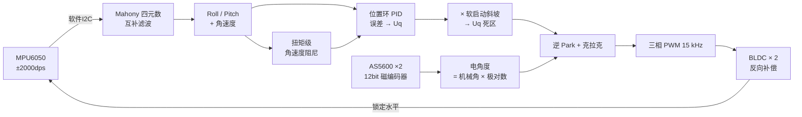

# 二轴自稳云台 · STM32F103 + MPU6050 + FOC

> **English** — A 2-axis (roll + pitch) self-stabilizing gimbal on STM32F103. Attitude is estimated with a Mahony quaternion complementary filter; a position loop outputs a torque voltage `Uq`, which is converted into three-phase voltages via inverse Park / Clarke to drive two 3-phase BLDC motors in the compensating direction, locking the gimbal level.
>
> **中文** — 基于 STM32F103 的二轴（横滚 + 俯仰）自稳云台。MPU6050 采集姿态，经 Mahony 四元数互补滤波解算姿态角，位置环输出力矩电压 `Uq`，再经逆 Park / 克拉克变换生成三相电压，驱动两路三相无刷电机反向补偿，把云台锁定在水平位置。


---

## 1. 项目解决什么问题

云台要解决的核心问题是：**载体（车、机器人、手持设备）在运动中会持续晃动，导致其上的相机或传感器无法保持稳定指向。**

市面上有成品云台，但成品是黑盒——控制算法、参数整定过程、故障处理策略全都不可见、不可改。本项目的目标是**从零实现一套双轴增稳云台的完整软硬件链路**，并且把工程上真正会出问题的地方处理掉：

| 真实会遇到的问题 | 本项目的处理 |
|---|---|
| 上电时转子大角度回摆，线材被缠绕拉断 | **防缠线**：上电捕获当前位置为参考零点 + 角度误差取最短路径，转子绝不整圈旋转 |
| 进入自稳瞬间输出满力矩，转子猛摆 | **软启动斜坡**：500 ms 内 Uq 由 0 线性爬升到 1 |
| 传感器 I²C 接触不良，返回垃圾数据导致电机飞车 | **故障锁存停机**：连续 200 ms 通信失败即切断三相驱动并上报，需重新上电恢复 |
| 主程序跑飞后电机持续输出 | **独立看门狗** + 上电自检（`WHO_AM_I` / 电角对齐进度） |
| 电机在回中位持续嗡嗡抖动（极限环） | **Uq 死区**：|Uq| < 0.05 V 直接置零 |
| 出问题只能靠猜 | **分层串口诊断**：启动帧 / 对齐进度 / 传感器状态 / 100 ms CSV 数据流 |

**适用场景**：云台、机器人头部、车载相机稳定；也可以作为 STM32 + FOC + 姿态解算的学习参考工程。

---

## 2. 主要功能

| # | 功能 | 说明 | 状态 |
|---|---|---|---|
| 1 | **双轴自稳** | 横滚 + 俯仰两轴自动锁定水平，受外力扰动后自动回正 | ✅ |
| 2 | **Mahony 姿态解算** | 四元数互补滤波，陀螺零偏上电静态校准，无需磁力计 | ✅ |
| 3 | **FOC 电压矢量调制** | 逆 Park + 克拉克，用编码器电角度驱动两路三相无刷电机，15 kHz PWM | ✅ |
| 4 | **上电自动电角对齐** | 约 7 s，串口打印对齐进度 | ✅ |
| 5 | **防缠线** | 上电捕获转子当前位置为自稳参考零点，误差归一化取最短路径 | ✅ |
| 6 | **软启动斜坡** | 进自稳后 500 ms 内 Uq 由 0→1，避免转子猛摆 | ✅ |
| 7 | **传感器故障锁存停机** | 连续 200 ms I²C 失败 → 切断三相驱动 + 锁存 + 主动上报 | ✅ |
| 8 | **独立看门狗 + 上电自检** | 主循环喂狗 1 s 超时；MPU6050 在线检测 | ✅ |
| 9 | **实时调参输出** | 100 ms 输出姿态角、双电机转角、软启动系数（CSV，可直接绘图） | ✅ |
| 10 | **蓝牙摇杆控制** | 位置映射模式，满偏 ±45°；500 ms 断连保护，松手回中 | ✅ |
| 11 | **分轴数字滤波** | 只对俯仰外环角度做一阶低通（抑抖动），横滚不滤以保刚度 | ✅ |
| 12 | 电流闭环 | `Inlinecurrent.c` 为预留模块，**当前未启用** | ⚠️ 未实现 |

---

## 3. 安装方法

### 3.1 软件环境

| 项目 | 要求 |
|---|---|
| IDE | **Keil MDK 5**（或兼容的 ARMCC/AC5 编译器环境） |
| 器件支持包 | Keil 官网下载并安装 **STM32F1xx Device Family Pack (DFP)** |
| 调试器驱动 | ST-Link 或 J-Link 驱动（按你手上的下载器装） |
| 串口工具 | 任意串口助手（9600, 8N1），推荐带绘图功能的如 SerialPlot |

### 3.2 获取源码

```bash
git clone https://github.com/LiauBy/stm32-2axis-gimbal.git
cd stm32-2axis-gimbal
```

### 3.3 按实际硬件修改参数（**必做**）

打开工程前，先确认这两处与你手上的电机一致：

| 参数 | 位置 | 默认值 | 说明 |
|---|---|---|---|
| 电机极对数 | `User/main.c` → `M0_PP` / `M1_PP` | `7` | 填错会导致电角度错乱、电机不转或抖动 |
| 编码器方向 | `User/main.c` → `M0_DIR` / `M1_DIR` | `-1` | 取 `+1` 或 `-1`，方向不对电机反向跑飞 |
| 母线电压 | `User/main.c` → `FOC_Init(13.4)` | `13.4 V` | 按实际电源电压填写 |

### 3.4 编译

1. 用 Keil 打开 `Project.uvprojx`
2. **Build**（F7）
3. 若需要干净重编：双击 `keilkill.bat` 清理中间文件，或手动删除 `Objects/`、`Listings/` 后重新 Build

### 3.5 烧录

用 ST-Link / J-Link 连接 SWD（SWDIO / SWCLK / GND / 3V3），在 Keil 中 **Download**（F8）。

> ⚠️ **第一次上电前请架空云台或固定好线材**：上电会执行约 7 s 的电角对齐，期间电机会有动作。

---

## 4. 使用方法

### 4.1 接线（USART1，9600 8N1）

| 本机引脚 | 接到哪里 |
|---|---|
| PA9（TX） | USB-TTL 的 RX（看调试数据）；同时可接蓝牙模块的 RXD |
| PA10（RX） | 蓝牙模块 TXD（接收摇杆指令）；不接蓝牙时内部上拉，不会收到乱码 |
| GND | 与调试/蓝牙模块共地 |

### 4.2 上电与自检

1. 上电，串口立刻应收到 `BOOT`
2. 随后约 7 s 打印 `ALGN M0` → `ALGN M1` → `ALGN DONE`（电角对齐）
3. 打印 `MPU6050 OK` 表示姿态传感器在线（若为 `MPU6050 ERR` 请检查 PB12/PB13 接线）
4. 此后每 100 ms 输出一帧 CSV 数据（见第 5 节）

### 4.3 正常运行

- **不加任何输入**：云台自动锁定水平，用手拨动后会自动回正
- **蓝牙摇杆控制**（可选）：手机 APP 发送 `[joystick,LH,LV,RH,RV]`
  - 右摇杆水平方向 → 横滚目标角偏移
  - 左摇杆竖直方向 → 俯仰目标角偏移
  - 松手回中 → 偏移归零，云台回到水平锁定
  - 超过 **500 ms** 未收到摇杆包（关机 / 断连）→ 偏移自动归零，云台回水平

### 4.4 调参流程

1. 用串口绘图工具（如 SerialPlot）连接 **9600**，直接用 CSV 帧画曲线
2. 按下面的现象定位问题：

| 串口现象 | 判断 | 处理 |
|---|---|---|
| `M0/M1Angle` 列能画出三角波（需临时改成扫掠模式） | 电机能转 | 问题在传感器或控制参数 |
| `M0/M1Angle` 平线不动或有嗡嗡声 | 电机缺相 / 相序错 / 接线问题 | 检查三相接线与驱动板 |
| `IMU_Pitch` 能跟随指令 | 传感器与轴映射正常 | — |
| `IMU_Pitch` 不跟随 | MPU6050 装歪或轴向不对 | 调整安装或修改轴向映射 |
| `StartRamp` 停在 0 附近 | 软启动斜坡没爬满 | 检查是否反复触发 I²C 故障 |
| 回中位持续小抖 | PID 在小信号下持续微调 | 加大 `UQ_DEADBAND` 或降低 `Kp` |
| 俯仰抖动明显 | 加速度计振动灌进电机指令 | 加大 `ANGLE_LPF_TF`（0.03 → 0.05） |
| 横滚发软、跟手慢 | 相位滞后 | 检查是否误加滤波；横滚设计上**不滤波** |

3. 参数所在位置见下方「主要参数」表。

### 4.5 停机

- 正常停机直接断电即可
- 若串口出现 `SENSOR FAULT`：驱动器已被**锁存切断**，必须**重新上电**才能恢复

---

## 5. 输入输出示例

### 5.1 上电完整会话（串口输出）

```
BOOT
ALGN M0
ALGN M1
ALGN DONE
MPU6050 OK
```

### 5.2 稳定运行时的数据帧（每 100 ms 一帧）

格式：`Roll,Pitch,Yaw,M0Angle,M1Angle,StartRamp\r\n`

```
0.12,-0.34,105.67,2.145,1.032,1.000
0.08,-0.21,105.68,2.146,1.031,1.000
0.15,-0.30,105.70,2.144,1.033,1.000
```

| 字段 | 示例值 | 含义 | 正常范围 |
|---|---|---|---|
| `Roll` | `0.12` | 横滚角（度），自稳轴 | ≈ 0（±1° 内） |
| `Pitch` | `-0.34` | 俯仰角（度），自稳轴 | ≈ 0（±1° 内） |
| `Yaw` | `105.67` | 航向角（度） | 缓慢漂移（无磁力计，属正常） |
| `M0Angle` | `2.145` | 横滚电机转子角（rad） | 锁定后基本恒定（围绕上电捕获值） |
| `M1Angle` | `1.032` | 俯仰电机转子角（rad） | 同上 |
| `StartRamp` | `1.000` | 软启动斜坡系数 | 上电 0.5 s 后稳定为 `1.000` |

### 5.3 受扰后自动回正（同一轴的连续帧）

| 时刻 | Roll | 状态 |
|---|---|---|
| 稳定 | `0.05` | 正常锁定 |
| 用手拨了一下（约 t+0.1 s） | `-6.80` | 外力使云台偏离 |
| t+0.2 s | `-2.14` | 正在回正 |
| t+0.3 s | `0.09` | 已回到水平 |

### 5.4 输入示例（蓝牙摇杆）

线上格式为 `[...]`，`]` 作为帧结束符（无需换行）。

| 发送内容 | 设备解析 | 云台行为 |
|---|---|---|
| `[joystick,0,0,0,0]` | 横滚偏移 0，俯仰偏移 0 | 锁定水平 |
| `[joystick,0,0,50,0]` | 横滚偏移 = 50/100 × 45° = **+22.5°** | 横滚向右倾 22.5° 并锁定 |
| `[joystick,0,-100,0,0]` | 俯仰偏移 = −100/100 × 45° = **−45°** | 俯仰下倾 45° 并锁定 |
| 松手（回中） | 偏移回 0 | 回到水平 |
| 超过 500 ms 无数据 | 偏移强制归零 | 自动回水平（断连保护） |

> 死区为 `|摇杆值| < 8` 时视为回中，用于消除摇杆零点漂移。

### 5.5 故障上报

```
SENSOR FAULT
```

指连续 200 ms 检测到 MPU6050 或 AS5600 的 I²C 通信失败，驱动器已被切断并锁存。**需重新上电恢复。**

---

## 🔧 硬件清单与引脚

### 器件

| 器件 | 型号 / 说明 | 备注 |
|---|---|---|
| 主控 | STM32F103（中容量，72 MHz） | 启动文件 `startup_stm32f10x_md.s` |
| 姿态传感器 | MPU6050（六轴） | 量程 ±2000 dps / ±16 g，软件 I²C |
| 位置传感器 | AS5600 磁编码器 × 2 | 12 bit（0~4095 → 0~2π），软件 I²C |
| 电机 | 2804 三相无刷云台电机 × 2（12 槽 14 极，M0 横滚 / M1 俯仰） | 极对数 = 14 ÷ 2 = **7**，与代码 `M*_PP` 一致；换电机必须同步修改 |
| 电机驱动 | 三相无刷驱动板 | 使能脚 PA8，高电平使能 |
| 电源 | 母线 13.4 V | 相电压限幅 12 V，按实际电源调整 |
| 串口 / 蓝牙 | USART1 @ 9600，PA9 = TX / PA10 = RX | 调试输出与摇杆输入共用一路 |

### 引脚分配

| 功能 | 引脚 | 外设 |
|---|---|---|
| M0（横滚）三相 PWM | PA0 / PA1 / PA2 | TIM2 CH1 / CH2 / CH3 |
| M1（俯仰）A 相 | PA3 | TIM2 CH4 |
| M1（俯仰）B / C 相 | PA6 / PA7 | TIM3 CH1 / CH2 |
| 电机驱动使能 | PA8 | GPIO 推挽输出 |
| MPU6050 | PB12 = SCL / PB13 = SDA | **软件 I²C #1** |
| AS5600（M0） | PB10 = SCL / PB11 = SDA | **软件 I²C #2** |
| AS5600（M1） | PB6 = SCL / PB7 = SDA | **软件 I²C #3** |
| 控制时基 | — | TIM1，1 ms 中断 |

> **三条独立 I²C 总线**是刻意的设计：MPU6050 与两路编码器互不共用总线，既避免编码器高频读取拖慢姿态采样，也避免一条总线故障牵连全部传感器。

### 中断优先级

`USART1` 抢占优先级 **1**，高于 `TIM1` 的 **2**。

原因：TIM1 中断里要用软件 I²C 逐位翻转，最坏可能占用 0.5 ms 以上；而 9600 波特下约 1 ms 就来一个字节，串口中断必须能打断 TIM1，否则会溢出丢字节。

---

## 🏗 系统架构



---

## ⚙️ 控制流程

### 上电时序（顺序是有意设计的）

```
① Serial_Init()          串口最先初始化 —— 后面任何一步卡住，都能从串口帧定位
     立即发送 "BOOT"

② FOC_Init(13.4)
   ├─ PWM_Init()         先配 PWM 引脚（PA0~PA7 复用推挽）
   ├─ Motor_en()         再拉高 PA8 使能驱动
   │     ⚠️ 顺序不能反：否则使能瞬间 PWM 引脚还是浮空输入 → 驱动误动作
   ├─ AS5600_Init()
   └─ Check_Sensor()     电角对齐（约 7 s），打印 "ALGN M0" / "ALGN M1" / "ALGN DONE"

③ IMU_Init()             配 MPU6050 + 静止采样 500 次求陀螺零偏
     读 WHO_AM_I 判断在线 → 打印 "MPU6050 OK" / "MPU6050 ERR"

④ tripod_Iint()          捕获当前转子角为自稳参考零点，原地保持（防缠线）
   FOC_SoftStart_Begin() 清零软启动斜坡

⑤ Timer_Init()           开 TIM1 1 ms 中断（控制循环）
   IWDG_Init()           最后才开看门狗（前面初始化要好几秒，先开狗会被自己咬）
```

### 10 ms 控制循环

TIM1 每 1 ms 进一次中断，每 10 次执行一轮控制：

| 步 | 动作 | 说明 |
|---|---|---|
| 1 | 故障锁存检查 | 已停机则保持断电，不再控制 |
| 2 | 软启动斜坡推进 | **放在故障门之前**：偶发单次 I²C 故障只跳过本周期，不该把斜坡永远卡在 0 |
| 3 | 读 MPU6050 十四字节 + I²C 错误计数增量 | 用"本周期与上周期错误计数之差"判断本周期有无通信失败 |
| 4 | 连续 20 周期（200 ms）故障 → 锁存停机 | 防止垃圾数据驱动电机失控 |
| 5 | Mahony 姿态解算，`dt` 固定 10 ms | |
| 6 | 摇杆断连检测 | 500 ms 未收到摇杆包 → 偏移归零，回水平 |
| 7 | 角速度复制给阻尼项 | |
| 8 | 俯仰外环角度低通滤波 | **只滤俯仰，横滚不滤**（保刚度，避免相位滞后发软） |
| 9 | `M0_Set_Angle()` / `M1_Set_Angle()` | 双轴自稳输出 |
| 10 | 每 10 轮置位发送标志 | 100 ms 输出一帧串口数据 |

---

## 🔬 关键实现

### 1. Mahony 四元数互补滤波（`User/IMU.c`）

- 陀螺积分提供高频姿态，加速度计提供重力方向参考
- 用加速度计测得的重力方向与四元数推算方向**叉乘求误差**，经 PI 反馈修正陀螺角速度，抑制 roll / pitch 积分漂移
- 无磁力计，**Yaw 由 Z 轴陀螺积分得到，长时会缓慢漂移**（方案固有特性）
- `invSqrt()` 使用快速平方根倒数（`0x5F3759DF` 魔数 + 一次牛顿迭代）
- 四元数一阶积分 + 归一化防漂移

**参数**：`Kp = 1.5`、`Ki = 0`（云台振动大，积分会放大振动；陀螺零偏已在上电时静态校准）

### 2. FOC —— 电压矢量调制（`Hardware/DFOC.c`）

```c
Ualpha = -Uq * sin(angle_el);
Ubeta  =  Uq * cos(angle_el);
Ua = Ualpha + Vbus/2;
Ub = (√3·Ubeta − Ualpha)/2 + Vbus/2;
Uc = −(Ualpha + √3·Ubeta)/2 + Vbus/2;
```

- `angle_el = 机械角 × 极对数 × 方向 − 零电角`，由 AS5600 提供
- 加 `Vbus/2` 是单极性供电偏置，三相电压以 Vbus/2 为中心摆动

> ⚠️ **这是"开环电压模式"FOC**：控制量 `Uq` 直接由位置环 PID 输出，**没有 Id/Iq 电流闭环**。
> 原因是 STM32F103 无 FPU（浮点走软件库），10 ms 控制周期达不到电流环所需的带宽。

### 3. 位置环 + 扭矩级角速度阻尼

```c
Uq  = PID_Controller(&M0_ANG_PID, err, 0.01f);          // 位置环（只用 P）
Uq += M0_RATE_DAMP * (g_IMU_RollRate  * DEG_TO_RAD);    // M0 横滚
Uq -= M1_RATE_DAMP * (g_IMU_PitchRate * DEG_TO_RAD);    // M1 俯仰
```

- 阻尼项把陀螺测得的角速度直接叠加进 Uq，相当于给电机加"粘滞阻尼"，吸收振荡能量
- **两轴符号必须相反**（因 `ROLL_GAIN = −1`、`PITCH_GAIN = +1`），搞反会正反馈锁死
- 阻尼用陀螺直接测的角速度，比"角度差分求微分"更干净，也避免了 D 项的噪声放大

### 4. 防缠线设计 ★

```c
M0_angle_ref = GetAngle(&Angle_Sensor0);   // ① 把当前转子位置捕获为参考零点

static float AngleErr(float err)           // ② 误差归一化到 (−π, π]
{
    float a = fmodf(err + PI, _2PI);
    if (a < 0.0f) a += _2PI;
    return a - PI;
}
```

误差相对**上电位置**计算（而非编码器绝对零点），并取**最短路径** → 即使多圈累计角与参考零点差 2π 整数倍，误差也不会超过半圈，**转子最多转目标所需角度**。

### 5. 传感器故障锁存停机 ★

```c
if (mpu_read_fail || mpu_delta || as_delta) {
    if (++SensorFault >= 20) { FOC_Disable(); return; }  // 连续 200 ms 故障
    return;                                              // 偶发故障：跳过本周期
}
```

`FOC_Disable()` = 锁存标志 + 通知主循环上报 + 拉低 PA8 **切断三相驱动**。触发后需重新上电恢复 —— 宁可停机，不可带故障运行。

### 6. 软启动与 Uq 死区

- **软启动**：`g_StartRamp` 从 0 → 1，50 周期（500 ms）线性爬升，乘在 Uq 上
- **Uq 死区**：`|Uq| < 0.05 V` 直接置 0，消除回中位的**极限环**（小信号下 PID 持续微调导致电机嗡嗡抖动）

### 7. 分轴低通滤波

```c
float a = ANGLE_LPF_TF / (ANGLE_LPF_TF + 0.01f);   // ANGLE_LPF_TF = 0.04 s
PitchF = a * PitchF + (1.0f - a) * IMU_Pitch;
```

只对**俯仰**外环角度做一阶低通（滤掉加速度计振动灌进电机指令的持续抖动），**横滚不滤**以保刚度。只滤角度，不滤速率阻尼。

### 8. 串口发送与浮点打印

- `Serial_SendByte()` 带**超时保护**，USART 异常时不会死循环
- `Serial_PrintFloat()` 用**定点拼接**输出浮点，不用 `%f`——避免标准库浮点打印的栈开销与依赖
- 接收用状态机拆帧：遇 `[` 开始收集、遇 `]` 置标志；上一帧未处理完时新帧丢弃（防撕裂）；缓冲区带边界保护，垃圾数据不会溢出

---

## 📋 主要参数

| 参数 | 值 | 位置 |
|---|---|---|
| 电机极对数 `M*_PP` | 7 | `User/main.c` |
| 编码器方向 `M*_DIR` | −1 | `User/main.c` |
| 自稳目标角 | 0°（水平） | `ROLL_TARGET` / `PITCH_TARGET` |
| 补偿增益 | `ROLL_GAIN = −1.0` / `PITCH_GAIN = +1.0` | `User/main.c` |
| 俯仰低通时间常数 | 0.04 s | `ANGLE_LPF_TF` |
| Mahony Kp / Ki | 1.5 / 0 | `User/IMU.c` |
| 位置环 PID（M0 / M1） | Kp = 5.0 / 3.0，Ki = Kd = 0，限幅 6.7 V | `Hardware/DFOC.c` |
| 速率阻尼 `M*_RATE_DAMP` | 0.15 V/(rad/s) | `Hardware/DFOC.c` |
| 软启动周期数 | 50（= 500 ms） | `START_RAMP_CYCLES` |
| Uq 死区 | 0.05 V | `UQ_DEADBAND` |
| 故障判据 | 连续 20 周期（200 ms） | `User/main.c` |
| 摇杆满偏范围 | ±45° | `JOY_RANGE_DEG` |
| 摇杆死区 / 断连超时 | 8 / 500 ms | `User/main.c` |
| 看门狗超时 | ≈ 1 s（LSI/64，重载 625） | `System/Timer.c` |

---

## 📁 目录结构

```
.
├── User/                  应用层
│   ├── main.c             主流程 + 上电时序 + 10 ms 控制中断
│   ├── IMU.c/.h           Mahony 四元数互补滤波姿态解算
│   └── stm32f10x_it.c     其他中断
├── Hardware/              驱动层
│   ├── DFOC.c/.h          FOC 核心：逆 Park/克拉克、电角计算、软启动、故障停机、防缠线
│   ├── PWM.c/.h           TIM2/TIM3 六路 PWM
│   ├── AS5600.c/.h        磁编码器驱动（12 bit + 多圈累计）
│   ├── MPU6050.c/.h       六轴传感器驱动
│   ├── MyI2C.c/.h         软件 I²C（MPU6050）
│   ├── IWI2C.c/.h         软件 I²C（两路 AS5600，按轴切换引脚）
│   ├── PID_control.c/.h   通用 PID（梯形积分 + 积分限幅）
│   ├── Serial.c/.h        串口收发、定点浮点打印、帧状态机
│   ├── Lowpass_Filter.c/.h ⚠️ 预留，未启用（低通内联在 main.c）
│   └── Inlinecurrent.c/.h  ⚠️ 预留，未启用（相电流采样，见「已知限制」）
├── System/                时基与看门狗（TIM1 1 ms 时基 + IWDG）
├── Library/               STM32 标准外设库（ST 官方）
├── Start/                 启动文件与 CMSIS
├── docs/                  实物照片
├── mechanical/            3D 打印件（STL）—— 云台支架 1 / 2 / 3
├── Project.uvprojx        Keil MDK 工程文件
├── keilkill.bat           清理 Keil 中间文件
├── README.md
├── LICENSE
└── .gitignore
```

---

## ⚠️ 已知限制

诚实说明当前版本的边界，欢迎在此基础上改进：

| # | 限制 | 说明 / 改进方向 |
|---|---|---|
| 1 | **无电流环** | 只有位置环，`Uq` 直接给定。低速 / 堵转时力矩不可控。改进：接入 `Inlinecurrent.c`（ADC + DMA 采样电阻）→ Clarke/Park → Id/Iq 双 PI |
| 2 | **控制周期 10 ms 偏慢** | 云台通常需要 400 Hz~1 kHz。F103 无 FPU 是瓶颈，可定点化或换 F4 系列 |
| 3 | **无磁力计** | Yaw 会缓慢漂移，属方案固有特性 |
| 4 | **PWM 无互补输出与死区配置** | 6 路独立 PWM，依赖外部驱动芯片内部产生互补与死区，选型时需确认 |
| 5 | **MPU6050 DLPF 关闭** | `CONFIG = 0x00`。可开启 DLPF（如 `0x03` ≈ 44 Hz）进一步降噪 |
| 6 | **加速度计量程 ±16 g 偏大** | `ACCEL_CONFIG = 0x18`。云台只需重力方向，±2 g 分辨率更高 |
| 7 | **速度环未启用** | `M0/M1_Set_Velocity` 与 `GetVelocity` 已实现但未接入 |

---

## 🖼 实物与结构件

- **实物照片**：[`docs/实物图.jpg`](docs/实物图.jpg)
- **结构件（STL）**：[`mechanical/`](mechanical/) —— 云台支架 1 / 2 / 3，可直接 3D 打印

> 电机原厂工程图属第三方版权素材，**未随本仓库分发**；极对数等参数以文字形式记录在「硬件清单」一节。

---

## 🙏 致谢与参考

- **STM32 标准外设库 / CMSIS**：STMicroelectronics、ARM Limited（文件头版权声明均原样保留）
- **逆 Park / 克拉克变换的实现写法**：参考了 SimpleFOC 等开源 FOC 项目的思路
- **软件 I²C 时序**：参考常见教学实现，本工程按 320 kHz 时序（SCL 脉宽 ≥1 µs）手写
- **`Inlinecurrent.c`**：为后续电流环预留的模块，当前版本未启用，请勿误认为已实现
- **2804 云台电机参数**（12 槽 14 极 → 极对数 7）：引自公开产品参数，用于核对代码中的 `M*_PP`

### 素材说明

仓库内所有图片（`docs/实物图.jpg`）与结构件（`mechanical/*.stl`）均为**作者自行拍摄 / 自行设计**。
未收录任何第三方图片、厂商工程图或截图。

若无特别说明，本仓库**源码部分**采用 MIT 许可；`Library/`、`Start/` 下的 ST / ARM 官方文件仍遵循其原始许可，版权归原权利人所有。

---

## 📄 License

[MIT](LICENSE)

---

## 📬 联系

- GitHub：[@LiauBy](https://github.com/LiauBy)
- 有问题、建议或想交流，欢迎直接开 [Issue](https://github.com/LiauBy/stm32-2axis-gimbal/issues)

> 如果这个项目对你有帮助，欢迎 Star ⭐
